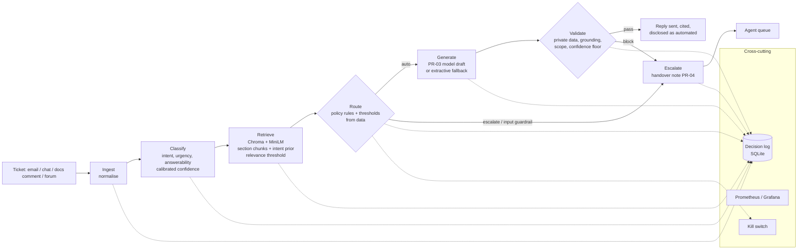

# Architecture and design decisions

## 1. What the system is for

The client asked for a chatbot. The evidence (docs/discovery_evidence.md) says the support function
does not lack answers: 71.4 % of tickets are answerable from the 29-article knowledge base (E1.7), and
49.1 % of tickets that were escalated to tier two could have been answered from it (E1.8). What fails
is *reaching* the answer (agents do not use the search; customers' words do not match article titles)
and *handing over* the hard ones (escalations arrive as a forwarded ticket with no context).

So the system has two equally important outputs: a cited reply for the tickets the documentation
genuinely answers, and a handover note for every other ticket. Escalation is a product, not a failure.

## 2. High-level view

Three layers (Brief, figure 4):

| Layer | Contents | Swappable because |
|---|---|---|
| Interface | `src/api.py` (FastAPI), `evaluation/harness.py` (batch), `src/demo.py` | both call `SupportSystem.process()` only |
| Processing | `ingest`, `classify`, `retrieve`, `route`, `generate`, `guardrails`, orchestrated by `pipeline.py` (LangGraph) | each component is a plain function/class with dataclass inputs and outputs (`schemas.py`) |
| Persistence and providers | `logging_store.py` (SQLite), Chroma store, `provider.py` (OpenRouter/Groq), model artefacts in `storage/` | provider and vector store sit behind small interfaces with local fallbacks |

## 3. Decisions (ADRs)

Each decision lists the alternatives considered and the evidence that settled it.

### ADR-01 Orchestration: LangGraph, with an identical built-in executor as fallback
* **Decision.** The six stages are LangGraph nodes; routing, "cannot answer" and guardrail blocks are
  conditional edges; every path ends in `finalise`, which writes the decision log in one transaction.
* **Why.** Prescribed stack; makes the routing branches explicit and inspectable.
* **Alternative.** Plain function calls. Kept as `_SimpleGraph` with the same nodes and edges so that
  an orchestration import problem on an assessor's machine cannot stop the run (gate A9). The engine
  used is written into every metrics report.

### ADR-02 Classification: calibrated supervised model, not a prompt
* **Decision.** TF-IDF (word 1-2 grams + character 3-5 grams) + logistic regression, trained on the 500
  development tickets; isotonic calibration for intent, Platt scaling for urgency and answerability.
* **Why.** Deterministic (A5), ~2 ms per ticket (latency target), free (cost NFR), and its confidence can
  be measured against accuracy (governance condition: within 5 points). Out-of-fold intent accuracy is
  100 % on development data and 100 % on validation, so a language model would add cost and variance
  without adding accuracy.
* **Evidence that changed it.** Sigmoid calibration left intent confidence 26 points *under* its
  accuracy (ECE 0.27) - switched to isotonic (ECE < 0.01). See revision log.
* **Limitation.** Intent is easy because tickets are templated (216 distinct bodies in 500, E9). Urgency
  and answerability are not reliably predictable from text at all (E9 ceilings 73 % and 87 %).

### ADR-03 Chunking by article section
* **Decision.** One chunk per section (symptoms, common causes, resolution, notes), each prefixed with
  the article title and applies-to line. Chunk ids are `DOC-XXX-NNN#section`.
* **Alternative measured.** Fixed 800/120-character splitting (Setup Guide default).
  `evaluation/results/retrieval_experiment.md`: similar top-1 article accuracy (97.2 % vs 98.3 % with the
  intent prior, TF-IDF), but the fixed splitter delivers the complete numbered resolution to the
  generator in only 6-10 % of cases against 100 % for section chunks. Incomplete steps read as wrong
  answers, so section chunking was chosen.

### ADR-04 Ranking: similarity plus an intent prior, with a relevance floor
* **Decision.** Score = 0.65 x semantic similarity + 0.35 x P(article | predicted intent) x intent
  confidence, where P(article | intent) is learned from development labels. Nothing below the
  backend-specific relevance threshold is returned.
* **Why.** Ines Varga: customers do not use the words in article titles. The prior bridges vocabulary
  mismatch, which matters most for non-fluent writers. Top-1 article accuracy rises from 89 % to 97 %
  on development data (TF-IDF).
* **Threshold.** The 5th percentile of the score of the correct article on answerable development
  tickets (95 % of real matches clear it). Computed per backend, because MiniLM cosine scores and TF-IDF
  scores are on different scales; the first run with Chroma calibrates and records its own threshold.

### ADR-05 Generation: model draft with an extractive fallback
* **Decision.** With a provider key, PR-03 asks the model for JSON sentences each carrying citations.
  Without a key, or on any provider failure, the reply is built from the article's resolution steps.
* **Why.** A11 requires graceful degradation including total provider loss; the extractive reply is
  grounded by construction (hallucination impossible), costs nothing and takes ~1 ms. The model is used
  to make replies more specific to the ticket, and is then held to the same grounding check.
* **Disclosure.** Every automatic reply says it was drafted automatically and that replying reaches an
  engineer with the context attached (Ravi Menon: "I calibrate how much I trust it").

### ADR-06 Guardrails block; they never redact and send
* Input-side: instruction injection, secrets/identifiers in the ticket. Output-side: private data,
  grounding (citation resolves to a retrieved passage and the passage contains the sentence's content
  words and numbers), tone and scope (no refunds, fixes, dates, roadmap), confidence floor.
* Any failure blocks the reply, escalates the ticket and records which check fired and what it found.
* Quoting the documentation is not treated as the system making a commitment (scope check ignores
  phrases present in the cited passage).

### ADR-07 Thresholds chosen by simulated cost, not by feel
* `python -m src.train` simulates the whole routing policy on 5-fold out-of-fold predictions and
  chooses the answerability threshold with the lowest expected cost, a wrong automatic reply counting
  twice an unnecessary escalation, subject to zero automatic replies to never-auto classes.
* Result: 0.54 (docs/threshold_analysis.md, with the full sweep and a sensitivity table: the choice
  holds for cost ratios 1x-2x and moves to 0.74 at 3x).
* The first version of this rule required 90 % automation precision; no threshold can achieve that on
  this data (label noise), so it would have escalated everything. See the revision log.

### ADR-08 Decision log in SQLite with masked inputs
* One row per stage plus one `final` row per ticket; reconciliation = count(final) == tickets processed.
* Inputs are stored as a masked 240-character summary plus a SHA-256 of the full text: enough to audit
  and to find the original ticket, without copying keys or e-mail addresses into a second store.
* Each row records the prompt version and requirement ids, so "was this behaviour intended?" can be
  answered from the log alone.

### ADR-09 Kill switch as a file checked per ticket
* Presence of `storage/KILL_SWITCH` (or `AUTO_RESPOND_ENABLED=false`) routes every following ticket to a
  person. No restart, takes effect on the next ticket, testable (tests/test_failures.py).

### ADR-10 Dependencies: Chroma's ONNX MiniLM instead of sentence-transformers
* The pack's `requirements.txt` pins `langchain==0.1.0`, `langgraph==0.0.20`, `chromadb==0.3.21`,
  `sentence-transformers==2.2.2`; that combination is no longer installable together on current Python
  (sentence-transformers 2.2.2 imports an API removed from `huggingface_hub`) and pulls PyTorch (~2 GB).
  The repository pins a current, mutually compatible set and uses Chroma's bundled ONNX build of the same
  all-MiniLM-L6-v2 model, which needs no PyTorch.

## 4. Failure behaviour (A11)

| Condition | Behaviour | Test |
|---|---|---|
| Provider timeout / 5xx | 3 retries with exponential backoff, then extractive reply | test_failures.py |
| Rate limited (429) | client-side throttle; on 429 honour Retry-After, retry | test_rate_limit_is_retried |
| Provider disconnected entirely | circuit opens after 3 failed tickets (60 s cool-off); extractive replies continue | test_provider_disconnected_entirely_pipeline_still_answers |
| No retrieval hit | nothing returned; ticket escalated "no relevant documentation" | test_no_retrieval_hit_escalates |
| Malformed input (None, numbers, lists, empty, control chars, 100k chars) | normalised with warnings; escalated or answered; never raises | test_malformed_and_hostile_input_never_crashes |
| Classifier artefact missing / corrupt | retrained automatically; if impossible, fallback class -> escalate | test_defined_fallback_instead_of_exception |
| Chroma / embedding model unavailable | local TF-IDF backend, recorded in every decision | conftest (RETRIEVAL_BACKEND=tfidf) |
| Unexpected exception anywhere | ticket escalated as `error_escalated`, final decision still logged | pipeline `_emergency` |

## 5. What I would restructure next

* Replace the noisy urgency model with an explicit production-impact detector (keywords and channel) -
  urgency labels are not predictable from text (E9).
* Use the LLM to rewrite non-fluent tickets into a normalised query before retrieval and answerability
  scoring (fairness finding).
* Move the decision log to PostgreSQL if more than one API worker runs.
